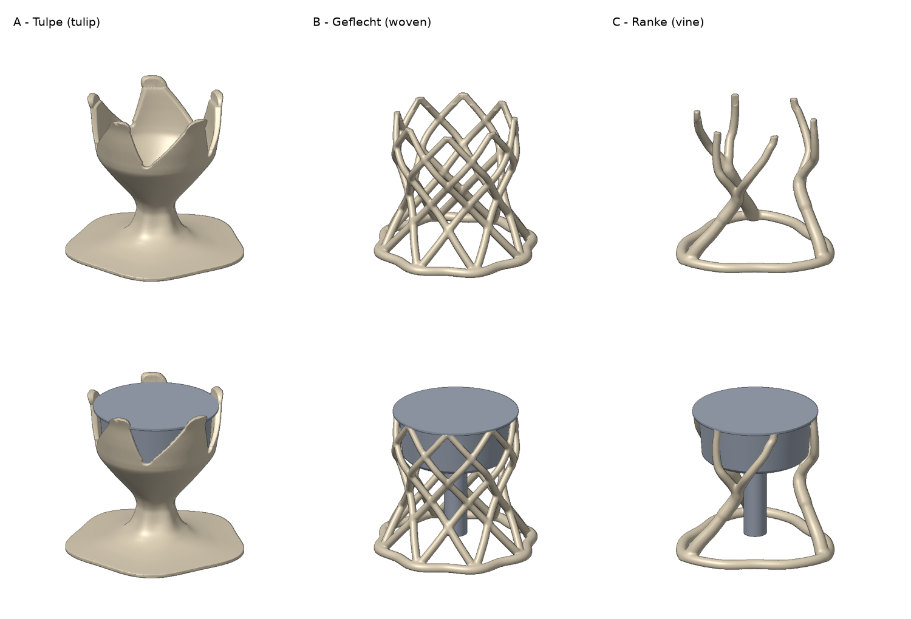
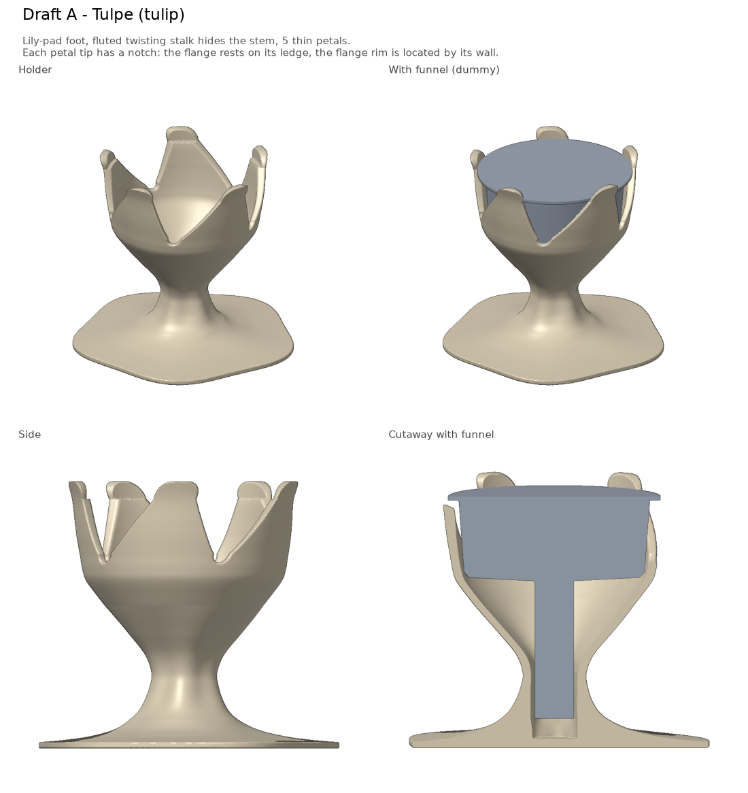
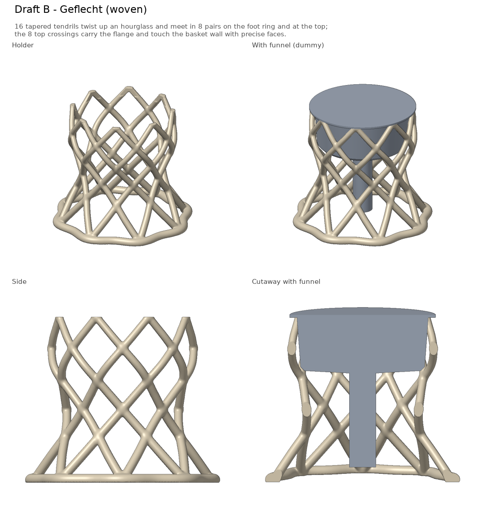
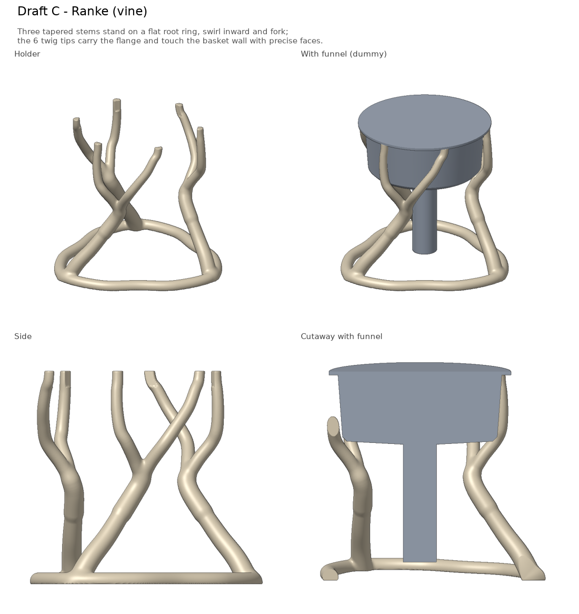

# Bialetti Filter Stand 3D Model Designs

A stand for the funnel (filter basket) of a Bialetti moka pot, made to be 3D printed
in PLA on an Anycubic i3 Mega.

## V1 Following the original Bialetti design


An octagonal hourglass body that echoes the Moka Express. The funnel sits in a 45°
conical seat. That centres it, but the seat is wide enough to take funnels of other
sizes too. The stem hangs into a closed shaft that also catches stray grounds.

The model is parametric. Every dimension is in the "Parameters" spreadsheet of
`v1/funnel_holder.FCStd`. To rebuild it headless:

```sh
cd v1
~/Applications/FreeCAD_1.1.4-Linux-x86_64-py311.AppImage freecadcmd build_holder.py
```

## V2 Natural slim design



Three organic drafts for a stand that fits one specific funnel. The funnel touches
only a few small, exact surfaces with 0.2 mm clearance, instead of v1's wide cone.
Every draft is a single closed part that prints upright without supports. The files
are in `v2/drafts/`.

### Draft A – Tulpe (tulip)

A lily-pad foot, a slender fluted stalk with the stem hidden inside, and 5 thin petals
that twist slightly and curl up past the rim.

**Where the funnel touches:** the rim rests on a small ledge in each of the 5 petal tips.
The wall above each ledge holds the rim's edge (Ø 60.4 mm, locating the 60 mm rim).



### Draft B – Geflecht (woven)

16 thin strands twist up an hourglass in opposite directions, like a woven basket,
and stand on a wavy foot ring. This is the most airy draft.

**Where the funnel touches:** the strands meet in 8 small pads at the top. The rim rests
on them, and their inner faces touch the basket wall (Ø 54.4 mm).



### Draft C – Ranke (vine)

Three stems stand on a flat root ring, swirl inward and each fork into two twigs.
This is the lightest draft.

**Where the funnel touches:** the 6 twig tips. The rim rests on top of them, and their
inner faces touch the basket wall (Ø 54.4 mm).



### Checks

| Draft | Size (mm) | PLA if solid | Overhang over 45° | Clash with funnel |
|---|---|---|---|---|
| A – Tulpe | 85 × 85 × 75 | ~47 g | none | none |
| B – Geflecht | 80 × 80 × 68 | ~18 g | ~100 mm², tiny blends where strands cross | none |
| C – Ranke | 74 × 76 × 68 | ~12 g | ~5 mm², one small blend | none |

The overhangs in B and C are millimetre-sized blends where strands meet. They bridge
fine without support. In the exported STLs, the contact faces are within 0.001 mm of
their target size.

### Files

All in `v2/drafts/`:

- `draft_*.FCStd`: open in FreeCAD. Each holds the stand (as a mesh) and a dummy of the
  funnel in its resting position.
- `draft_*.stl`: ready to slice.
- `draft_*.png`: views of each draft (holder, with funnel, side, cutaway).
  `drafts_overview.png` shows all three at the same scale.
- `draft_*.json`: seat height and funnel dimensions, used by `make_fcstd.py`.
- `organic.py`: shared code. It holds the funnel dimensions, the fit, the modelling
  helpers and the preview renderer.

### Rebuild

```sh
cd v2/drafts
uv run draft_a_tulip.py      # likewise for the b and c drafts; writes .stl .json .png
uv run overview.py
~/Applications/FreeCAD_1.1.4-Linux-x86_64-py311.AppImage freecadcmd make_fcstd.py
```

`uv run` installs the Python dependencies listed at the top of each script.

### How the shapes are built

The organic body is modelled as a signed distance field (tapered tubes, revolved
shells and smooth blends) and turned into a mesh with marching cubes. The precise
contact surfaces are exact cylinder and plane cuts, applied in the distance field
before meshing. The fit therefore doesn't depend on the mesh resolution, and the
STL stays a clean closed solid.

### Open points

- The funnel dimensions are in `FUNNEL` at the top of `v2/drafts/organic.py`. Only the
  rim diameter (60 mm) comes from v1. The rest are placeholders until they are measured.
- The clearance on the contact surfaces is `FIT = 0.20 mm`, also in `organic.py`.
  The final model will come with a small fit-test ring to check it on the printer
  first.
